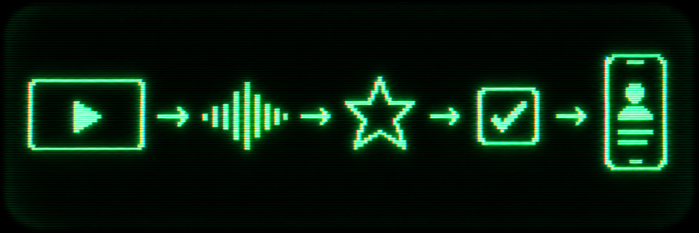
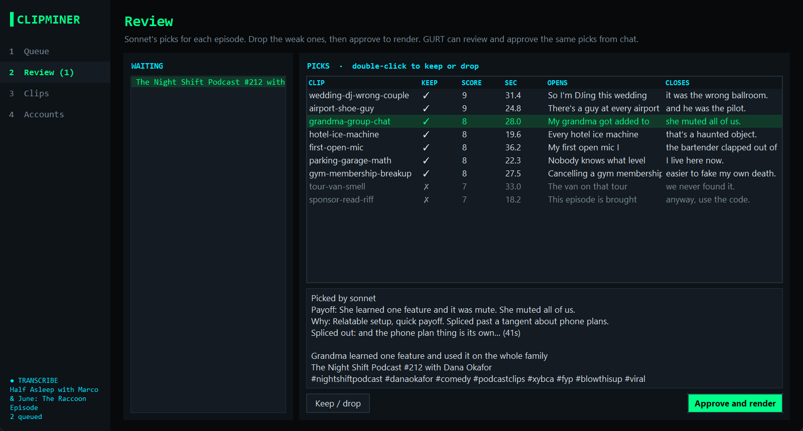
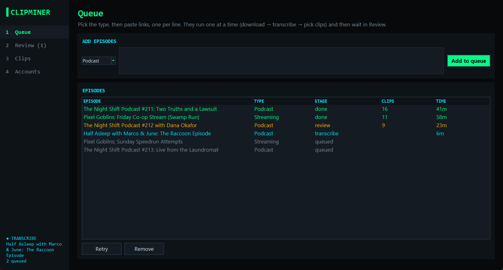
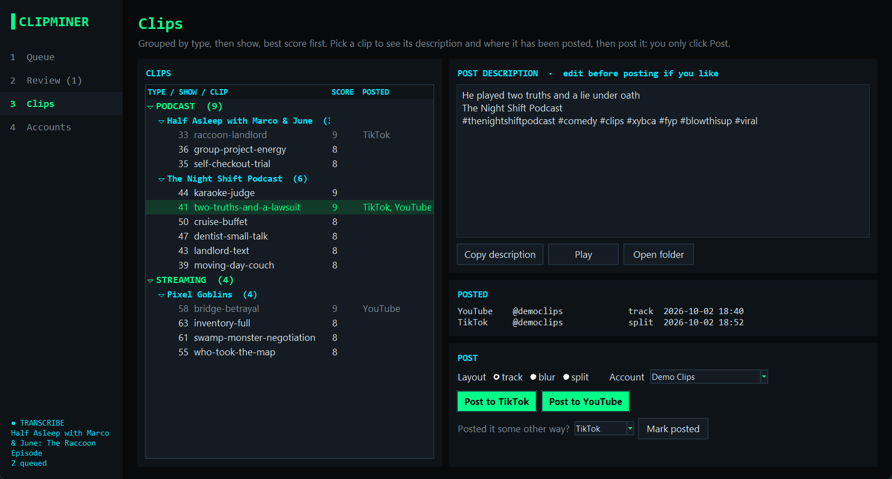

<!-- Hero: CRT wordmark — see docs/assets/README.md for the image-gen prompt. -->
<p align="center">
  
</p>

<p align="center">
  <strong>Long video in. Clips out.</strong><br/>
  Paste a YouTube link to a podcast or stream and get the moments worth posting: vertical, captioned, scored, and ready to upload once you approve them.
</p>

<p align="center">
  
  
  
  
  
</p>

<p align="center">
  <a href="#what-it-does">What it does</a> ·
  <a href="#screenshots">Screenshots</a> ·
  <a href="#get-started">Get started</a> ·
  <a href="#a-run-start-to-finish">A run</a> ·
  <a href="#layouts">Layouts</a> ·
  <a href="#how-clips-get-picked">Picking</a> ·
  <a href="#posting">Posting</a> ·
  <a href="#architecture">Architecture</a>
</p>

---

ClipMiner turns a long comedian podcast or a game stream into short clips for TikTok, YouTube, Instagram and
Facebook. It downloads the video from YouTube, transcribes it on your GPU, has Claude pick the moments that land, and then
**stops and waits for you**. Nothing is rendered until you approve the picks, and nothing is ever posted for you.

## What it does

<p align="center">
  
  <br/><sub><b>The pipeline</b> — download → transcribe → score → review → render</sub>
</p>

- **Finds the clips for you** — every pick gets a 1–10 score, a one-line reason and the payoff line it is built
  around. Only picks scoring 8 or higher are submitted.
- **You stay in charge** — picks land in a Review page. Keep or drop each one, then approve. At most 20 clips per
  video, or 30 for a video over three hours.
- **Vertical and captioned** — 1080×1920, with word-timed captions burned in, up to three words at a time.
- **Follows who is talking** — the crop tracks the active speaker, and stacks two people when they share the shot.
  Streams get the webcam above the gameplay.
- **Tightens long stories** — a setup and its payoff can be spliced together with jump cuts, and dead air is
  shortened where the audio really goes quiet.
- **Post text included** — each clip comes with a hook, a credit line for the show and guest, and hashtags in a
  `.txt` beside it.
- **Fills the upload page** — pick an account and a platform; ClipMiner opens that account's browser, attaches the
  clip and fills in the caption. You click Post.
- **Keeps it clean where it counts** — curse words are masked in the captions (the audio is untouched), and a word
  filter refuses post text containing common swearing, sex or drug terms before it can render or post.
- **Picks up where it left off** — every stage caches its result, so a crash resumes instead of starting over.

## Screenshots

<p align="center">
  
  <br/><sub><b>Review</b> — every pick with its score, length, payoff and reason. Keep or drop, then approve.</sub>
</p>

<table>
  <tr>
    <td width="50%" valign="top">
      <br/>
      <sub><b>Queue</b> — paste links and walk away. Jobs run one at a time and wait for you in Review.</sub>
    </td>
    <td width="50%" valign="top">
      <br/>
      <sub><b>Clips</b> — finished clips by show, best score first, with the post text and where each was posted.</sub>
    </td>
  </tr>
</table>

<p align="center"><sub>The shows, clips and account in these screenshots are made-up demo data.</sub></p>

## Get started

There is no installer yet: setup takes a terminal and about ten minutes. The repo is private, so cloning needs
collaborator access.

> **You need:** Windows with an NVIDIA GPU (transcription uses CUDA), Python 3.12, ffmpeg, an Anthropic API key,
> and Chrome installed in its default system-wide location if you want ClipMiner to fill upload pages.

1. Get the code and install it:
   ```powershell
   git clone https://github.com/TylerKomander/ClipMiner
   cd ClipMiner
   python -m venv .venv
   .\.venv\Scripts\pip install -r requirements.txt
   winget install ffmpeg
   setx ANTHROPIC_API_KEY "<your key>"
   ```
2. **Open a new terminal** in the same folder, so ffmpeg is on your PATH.
3. Open the app:
   ```powershell
   .\.venv\Scripts\python.exe -m clipminer.gui
   ```

> **The key lives in your user environment, not in this repo.** ClipMiner reads `ANTHROPIC_API_KEY` from the
> Windows user environment each time it scores, so a key you just set works without restarting anything.

## A run, start to finish

1. **Queue** — choose **Podcast** or **Streaming**, paste one or more YouTube links, and add them.
   Jobs run one at a time in the background: download, transcribe, measure loudness, score.
2. **Review** — the job stops here. Read each pick's opening and closing words, score and reason. Double-click to
   keep or drop, then **Approve and render**.
3. **Clips** — finished clips are grouped by type and show, best score first. Play one, copy its description, or
   post it.
4. **Accounts** — one entry per set of social accounts, each with its own browser folder. You sign in once inside
   that browser. No passwords are stored.

Clips land in `Finished_Clips\<Podcast|Streaming>\<show>\`, named `NN_s<score>_<name>_<layout>.mp4`, with one
`NN_s<score>_<name>.txt` description shared by that clip's layouts. Once a video's clips are rendered, the
downloaded source is deleted; rendering more picks later downloads it from YouTube again.

Prefer the command line?

```powershell
.\.venv\Scripts\python.exe -m clipminer <url>                    # run up to the review stage
.\.venv\Scripts\python.exe -m clipminer <url> --kind stream      # a stream instead of a podcast
.\.venv\Scripts\python.exe -m clipminer                          # work through queue.txt (create it: one link per line)
.\.venv\Scripts\python.exe -m clipminer --render <slug>          # render every pick still marked keep in work\<slug>\review.json
```

On the command line there is no approval step: picks start out kept (except ones the code
dropped for length or for going over the clip limit, which are already `false`), so review by setting `"keep"` to
`false` in `work\<slug>\review.json` for the ones you don't want, then run `--render`.

## Layouts

Every clip is rendered more than one way, so you can post the variants and see which performs.

| Layout | File suffix | What you get | When |
|---|---|---|---|
| **Blur** | `_blur` | The full frame, centered over a blurred copy of itself | Every clip |
| **Track** | `_track` | A full-height crop that follows whoever is speaking, by jaw movement | Podcasts, and stream clips with no gameplay |
| **Split** | `_split` | Two speakers stacked, captions on the seam | When exactly two people share one shot |
| **Game** | `_game` | Webcam on top, gameplay under it; switches to the face when the stream cuts to the camera | Stream clips that show gameplay |

For streams, the webcam box is found when the first render starts. It is stored in `work\<slug>\facecam.json`, in
source-video pixels, with a half-size preview in `facecam.jpg`. If the box is wrong, override it with
`"facecam": [x, y, w, h]` in that job's `review.json`, using source-video pixels. Clips that have already rendered
are not redone on their own.

## How clips get picked

The judgment lives in two places you can read and edit:

- [`skill.md`](skill.md) is the rulebook: what a good clip is for each type of video, and how to find, cut and
  describe one. The scorer reads all of it on every run.
- [`clip_log/`](clip_log/) holds one file per run with the clips that were kept and rejected, and why.
  [`clip_log/INDEX.md`](clip_log/INDEX.md) tallies the patterns across runs.

The scorer reads the transcript in 20-minute pieces with a minute of overlap, alongside per-second loudness and
YouTube's "most replayed" data when the video has it. It must quote a clip's payoff line before submitting it: no
payoff, no clip. Each clip's kept words have to run 10 to 40 seconds.

**What it can't do:** the scorer only reads the transcript. It cannot see the game or a visual gag, so stream
picks need a closer look in Review.

## Posting

Posting uses your installed Chrome through Playwright, one browser folder per account. ClipMiner opens the upload
page, attaches the clip, fills in the caption and stops. If a step fails, the browser stays where it stopped and
the caption is on your clipboard.

Four hashtags are added to every description (`REQUIRED_TAGS` in `clipminer/review.py`); change them there if they
are not yours.

Upload pages for TikTok, YouTube, Instagram and Facebook are wired in. Real posts so far have gone to YouTube and
TikTok; **the Facebook flow has never been run against a real page**, so expect to fix it on first use. Upload
pages change, and that will break this from time to time.

## Architecture

A small Python package, one module per stage. Everything a job produces is cached in `work\<slug>\`.

- `clipminer/download.py` — yt-dlp, up to 1080p; keeps the title, channel and "most replayed" heatmap
- `clipminer/transcribe.py` — faster-whisper on CUDA with word-level timestamps
- `clipminer/signals.py` — loudness per second, from ffmpeg's `ebur128`
- `clipminer/score.py` — the Claude call: rulebook and recent runs in a cached system prompt, structured picks out
- `clipminer/review.py` — the review gate (`review.json`), clip limits, clean-text checks, numbering, rendering approved picks
- `clipminer/splice.py` — story cuts and dead-air trimming
- `clipminer/reframe.py` — face detection, active-speaker tracking, the webcam box, and the layout filters
- `clipminer/render.py` — the ffmpeg cut with burned-in captions
- `clipminer/post.py` — fills upload pages with Playwright
- `clipminer/gui.py` — the tkinter app: Queue, Review, Clips, Accounts

[`CONTEXT.md`](CONTEXT.md) is the working log: decisions, status, known problems and what is next.
[`GUI_SPEC.md`](GUI_SPEC.md) is the original spec for the app.

## Credits

The split and track layouts were ported from [openshorts](https://github.com/mutonby/openshorts) (MIT). Face
detection uses OpenCV's YuNet model and MediaPipe's face landmarker, both included in `models/`.

<p align="center">
  <sub>A project by <strong>Tyler Komander</strong></sub>
</p>
